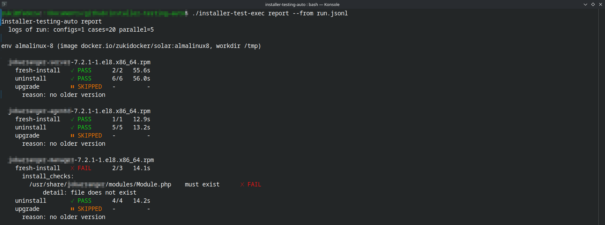
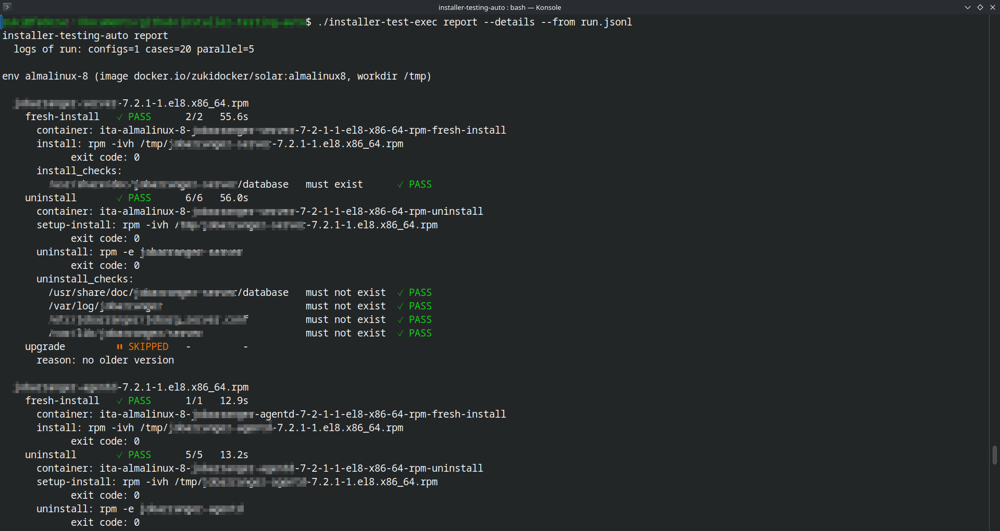

# installer-testing-auto

Automation tool to test installer files on target environments: **Linux**
containers via [testcontainers-go](https://golang.testcontainers.org/) and
**Windows Server Core containers** via the Docker Engine API (v4, see
[Windows environments](#windows-environments)). VM / WinRM environments are a
future environment type.

## How it works

1. Drop installer files into `bin/` (never committed).
2. Describe each target environment in `configs/<env>.yaml` — one file per environment:
   a Linux **or Windows** environment (`os:`), docker image, installer file patterns
   (**wildcards allowed**, with `{VAR}` variables set by `--var NAME=VALUE`), and
   optional per-installer checks (`must_exist`, `must_not_exist`, shell `commands`).
3. Run the tool: every **(installer file × task) pair** becomes an independent test
   case with **its own container**. Cases run in parallel through a **global pool** —
   `--parallel N` caps the total number of containers running at once (default 5).
   - `fresh-install` case: copy installer → install → install checks.
   - `uninstall` case (standalone): copy installer → install (setup, unchecked) →
     uninstall → uninstall checks.
   - `upgrade` case (standalone, requires versions like `MAJOR.MINOR.PATCH-suffix`
     in file names): copy old installer → install old (setup) → copy new installer →
     upgrade → `upgrade_checks`. Versions come from the built-in `.deb` / `.rpm`
     rules or from a [`version_format`](#version_format) (Windows: always
     `version_format`). Installers without older versions, whose file names carry
     no version, or (Windows) without a `version_format` are **skipped** and shown
     as such in the report. See `docs/upgrade-task-plan.md` for the pairing rules.
4. Output is **live JSON logs** (NDJSON, one event per line) — no summary at the end;
   the exit code is `0` only when every case passed.
5. Build a report afterwards from the captured logs with the `report` subcommand.

See `docs/installer-testing-tool-plan.md` (v1 baseline),
`docs/container-per-task-plan.md` (v2 design),
`docs/upgrade-task-plan.md` (v3 upgrade task),
`docs/shared-checks-presets-plan.md` (v3.1 shared presets),
`docs/wildcard-checks-pattern-vars-plan.md` (v3.2 wildcard checks + pattern
variables),
`docs/pattern-vars-unset-no-match-plan.md` (v3.3 unset variables match nothing),
`docs/upgrade-pool-pattern-vars-plan.md` (v3.4 widened upgrade pool),
`docs/list-upgrade-checks-plan.md` (v3.5 `list` shows upgrade checks) and
`docs/windows-environment-plan.md` (v4 Windows environments)
for the full design.

## Usage

```sh
# build
go build -mod=vendor -o installer-test-exec github.com/zukigit/installer-testing-auto/cmd/installer-test

# dry-run: show envs, matched installers, resolved commands
./installer-test-exec list

# run all tasks on all Linux environments (live JSON logs), max 5 containers at once
# (os: windows configs are not in the default set: name them with --config)
./installer-test-exec run | tee run.jsonl

# install cases only, 8 containers max
./installer-test-exec run --task fresh-install --parallel 8 | tee run.jsonl

# pattern variables: substitute {VERSION} into installer patterns
./installer-test-exec run --var VERSION=7.2.2 | tee run.jsonl

# one environment + installer filter
./installer-test-exec run --config configs/rocky-9.yaml --installer "bin/*.rpm" | tee run.jsonl

# keep containers of failed cases for debugging (container IDs are always logged)
./installer-test-exec run --keep | tee run.jsonl

# generate a text report from the captured logs
./installer-test-exec report --from run.jsonl
./installer-test-exec report --details --from run.jsonl   # steps + install_checks/uninstall_checks/upgrade_checks sections for every case
./installer-test-exec report --from - < run.jsonl      # from stdin

# remove leftovers of earlier runs (normally not needed, see Cleanup below)
./installer-test-exec cleanup                  # kept (--keep) containers stay
./installer-test-exec cleanup --include-kept   # kept containers too
```

**Default config set**: without `--config`, `run` and `list` use every
`configs/*.yaml` **except `os: windows` configs** — on every host. Windows
configs run only when named with `--config` (any explicit `--config`,
even `configs/*.yaml`, is used as given). `list` prints a `SKIPPED config
...` line for each Windows config it leaves out.

On Windows (see [Windows environments](#windows-environments)), cross-compile
in the devcontainer and run the `.exe` on the Windows host (PowerShell):

```powershell
# in the devcontainer
GOOS=windows GOARCH=amd64 go build -mod=vendor -o installer-test-exec.exe ./cmd/installer-test

# on the Windows host
.\installer-test-exec.exe list   --config "configs/<windows-glob>.yaml" --var VERSION=7.2.2
.\installer-test-exec.exe run    --config "configs/<windows-glob>.yaml" --var VERSION=7.2.2 > run.jsonl
.\installer-test-exec.exe report --from run.jsonl
```

## Example reports

A report generated from `run.jsonl` with `./installer-test-exec report --from run.jsonl`
(compact view, grouped by installer — PASS/FAIL with check counts and durations,
failure details inline):



The same logs with `./installer-test-exec report --details --from run.jsonl`
additionally shows, for every case, the container, the executed steps and the
`install_checks:` / `uninstall_checks:` (and `upgrade_checks:`) sections with
what was checked — paths, `must exist`/`must not exist` expectations, command
exit codes and stdout/stderr:



> Running `run` requires a Docker daemon; the devcontainer has none, so use a
> Docker-enabled host or mount the Docker socket. Linux configs need a
> Linux-containers engine, Windows configs a Windows-containers engine. There
> is no preflight: a mismatch fails that case at start with Docker's own error
> (`start docker environment: ...`), and all other cases keep running.

## Example config (`configs/example-ubuntu-24.04.yaml`, illustrative)

The real configs are `configs/jobarg-*.yaml`; a Windows example is in
[Windows example config + preset](#windows-example-config--preset).

```yaml
environment:
  name: ubuntu-24.04
  type: docker
  image: ubuntu:24.04

installers:
  - pattern: "bin/*.deb"          # wildcards allowed; {VAR} set via --var (see below)
    install_checks:
      commands:
        - command: "dpkg -s {package}"
    uninstall_checks:
      commands:
        - command: "dpkg -s {package}"
          expected_exit_code: 1
```

## Configuration reference

One config file = one target environment. An installer **pattern** resolves to
the **package list**: `install_command`, `uninstall_command` and `upgrade_command`
run once per matched file.

### `environment` (required)

| Key      | Required? | Description |
|----------|-----------|-------------|
| `image`  | **required** | Docker image name used for the container (e.g. `ubuntu:24.04`, `mcr.microsoft.com/windows/servercore:ltsc2022`). |
| `type`   | optional | Environment type. Default and only value: `docker` (Linux and Windows). |
| `os`     | optional | `linux` (default) or `windows`. Decides the command language (`sh` / PowerShell), the workdir default and the MSI defaults. Other values are a load error. |
| `isolation` | optional | **Windows only**: `process` or `hyperv`; unset = daemon default. Setting it with `os: linux` is a load error. |
| `name`   | optional | Environment name shown in reports. Default: config file basename (e.g. `configs/ubuntu-24.04.yaml` → `ubuntu-24.04`). |
| `workdir`| optional | In-container directory where installer files are copied. Default: `/tmp` (linux) / `C:\ita` (windows). On Windows it must be an absolute drive path (`D:\tests` works too); `/` is normalized to `\`. |

### `installers` (required, at least one entry)

| Key                | Required? | Description |
|--------------------|-----------|-------------|
| `pattern`          | **required** | Glob relative to the repo root (e.g. `bin/*.deb`). Must match at least one file, or the run fails. May contain `{VAR}` variables set via `--var NAME=VALUE` (see [Pattern variables](#pattern-variables-var-in-installer-patterns)). |
| `use_preset`       | optional | Name of a preset defined in the config's presets file (see [Shared presets](#shared-presets-configssharedpresetsyaml)). A preset may carry any installer key except `pattern`; a locally defined key beats the preset. |
| `install_command`  | optional | Install command template. Defaults by file extension (table below). |
| `uninstall_command`| optional | Uninstall command template. Defaults by file extension — **`.sh`, `.ps1` and non-MSI Windows types have no default, so it must be set explicitly for them**. |
| `upgrade_command`  | optional | Upgrade command template for the `upgrade` task, defaults by file extension (table below) — **`.sh`, `.ps1` and non-MSI Windows types have no default**. Used to upgrade from an **older version of the same package** (pairing rules below). |
| `version_format`   | optional | File-name template used **only by the `upgrade` task** to pair old and new installers, e.g. `"{package}-{version}-x64.msi"`. Required for upgrade testing on Windows. See [`version_format`](#version_format). |
| `install_checks`   | optional | Check block run after each installer's install command. All sub-keys optional. |
| `uninstall_checks` | optional | Check block run after each installer's uninstall command. All sub-keys optional. |
| `upgrade_checks`   | optional | Check block run after the upgrade command in `upgrade` cases. Same shape as the other check blocks. |

### Upgrade pairing

The `upgrade` task needs installer file names carrying versions:
**`MAJOR.MINOR.PATCH[-suffix]`**. Version sources:

- the built-in rules (Linux only, when `version_format` is unset):
  `.deb`: `name_VERSION_arch.deb`, `.rpm`: `name-VERSION-release[.arch].rpm`;
- a [`version_format`](#version_format) on the installer entry or its preset
  (any OS; **required on Windows**).

- For each installer, the tool finds every **older** version of the same
  package from the config's **upgrade pool** — the resolved package list
  **plus** every older version of the same package discoverable by widening
  the pattern variables (`{VAR}` → `*`) — and creates one upgrade case
  per pair: install the old version (setup) → run `upgrade_command` →
  run `upgrade_checks`.
- Version ordering: MAJOR.MINOR.PATCH compared numerically; then the suffix —
  numeric suffixes compared numerically (`0.1.1-1` < `0.1.1-2`), non-numeric
  suffixes (`-beta`, `-1.el9`) compared by the files' modification dates.
- Skips are `⏸ SKIPPED` in the report (never failures), with one of three
  reasons:

  | Reason | Meaning |
  |---|---|
  | `no_version_format` | Windows entry without `version_format` (no built-in Windows rule) |
  | `nonstandard_version` | the file name carries no parsable version (or does not match `version_format`) |
  | `no_older_version` | no older version of the same package in the upgrade pool |
- `list` prints a `pairing:` line per installer — the parsed version and
  package, or the skip reason it would get — so pairing can be checked before
  any container starts.
- Full pairing rules: `docs/upgrade-task-plan.md`.

### `install_checks` / `uninstall_checks` / `upgrade_checks` (all sub-keys optional)

| Key              | Required? | Description |
|------------------|-----------|-------------|
| `must_exist`     | optional  | List of file paths that must exist after the phase (e.g. `/usr/bin/myapp`). Entries containing `*`, `?` or `[` are **glob patterns** expanded by the container's shell (see [Wildcard file checks](#wildcard-file-checks)). On Windows, paths are probed with `Test-Path` / `Get-Item`, and registry paths (`HKLM:\SOFTWARE\...`) work too. |
| `must_not_exist` | optional  | List of file paths that must NOT exist after the phase. Same glob and Windows support. |
| `commands`       | optional  | List of command checks (see below), run via `sh -c` (Linux) or PowerShell (Windows). |

### Wildcard file checks

A `must_exist` / `must_not_exist` entry containing any of `*`, `?`, `[` is a
glob pattern. On **Linux** it is expanded by the **container's own `/bin/sh`**
(POSIX glob: `*`, `?`, `[...]`; `**` is not recursive). Files and directories
both count:

- `must_exist` glob: PASS iff the pattern expands to **at least 1** name
  (and the check event records every matched name, capped at 20).
- `must_not_exist` glob: PASS iff the pattern expands to **0** names.

```yaml
install_checks:
  must_exist:
    - /usr/share/man/man8/jobarg_server.8.*   # any compression/layout variation
uninstall_checks:
  must_not_exist:
    - /etc/jobarranger/jobarg_server.conf*    # incl. *.rpmnew leftovers
```

Exact paths (no glob characters) keep the literal `test -e` probe — existing
configs behave identically. Glob paths are passed **unquoted** to the shell,
so they are validated at load time: they may only contain letters, digits,
`/ . - _ + { }` and the glob metachars `* ? [ ]`. Anything else (whitespace,
`$`, `;`, quotes, ...) is a load error — use a `commands` check for such
paths.

On **Windows** the rules differ:

- Globs are PowerShell wildcards (`*`, `?`, `[...]`), expanded by `Get-Item`
  — non-recursive, files and directories, **hidden items included**,
  **case-insensitive**.
- The pattern is passed **quoted**, so there is no charset restriction:
  `C:\Program Files\Job Arranger\*.dll` is fine. Only control characters
  (newline, tab, NUL, ...) are a load error.
- Registry globs work too (`HKLM:\SOFTWARE\Microsoft\Windows\CurrentVersion\Uninstall\*`);
  matches are recorded as `HKEY_LOCAL_MACHINE\...`.
- Each probe starts one `powershell.exe` (≈0.3–1 s), so a check block with
  60 paths adds roughly a minute per case.

### `commands` entries

| Key                        | Required? | Description |
|----------------------------|-----------|-------------|
| `command`                  | **required** | Command run inside the environment: via `sh -c` (Linux) / Windows PowerShell 5.1 (Windows, see [PowerShell semantics](#powershell-semantics)). |
| `expected_exit_code`       | optional  | Expected exit code. Default: `0`. |
| `expected_stdout_contains` | optional  | Substring the command's output must contain. |

### Shared presets (`configs/shared/presets.yaml`)

The environment configs share their per-package checks and commands.
A **preset** = the same keys as an installer entry minus `pattern`:
`install_command`, `uninstall_command`, `upgrade_command`, `version_format`,
`install_checks`, `uninstall_checks`, `upgrade_checks` — each optional, any
combination.

```yaml
# configs/shared/presets.yaml
presets:
  server-rpm:
    install_checks:
      must_exist: ["/usr/share/doc/jobarranger-server/database"]
    uninstall_checks:
      must_not_exist: ["/var/log/jobarranger", "/etc/jobarranger/jobarg_server.conf"]
    upgrade_command: "echo new >> /etc/jobarranger/jobarg_server.conf && rpm -Uvh {installer}"
    upgrade_checks:
      must_exist: ["/etc/jobarranger/jobarg_server.conf.rpmnew"]
```

Each environment config names **one** presets file and references presets per
installer entry (paths are cwd-relative, like installer patterns):

```yaml
presets: configs/shared/presets.yaml   # optional; default: configs/shared/presets.yaml

installers:
  - pattern: "bin/jobarranger-server*el8*.rpm"
    use_preset: server-rpm
```

Merge rules — **per key, local wins**:

- A locally defined command/check block replaces the preset's entirely
  (no list unioning — no silent duplicates).
- Commands fall back: entry > preset > extension defaults table below.
- Exactly one preset per entry; no chaining or multiple presets.
- Unknown preset names, missing presets files (when used, or explicitly
  named but unused) and malformed presets files are config-load errors.

Presets files live under `configs/shared/`, which is **never treated as
environment configs** — even custom `--config` globs (e.g.
`configs/**/*.yaml`) skip that directory, so you can keep several presets
files side by side (e.g. per product). Windows presets can live in their own
file (e.g. `configs/shared/presets-windows.yaml`), selected with the config's
`presets:` key.

### Pattern variables ({VAR} in installer patterns)

A pattern can carry `{NAME}` variables (uppercase names, `NAME` matching
`[A-Z][A-Z0-9_]*`) that are substituted at load time from **`--var NAME=VALUE`**
command-line flags (repeatable, on `run` and `list`; last value wins, unused
names ignored):

```yaml
installers:
  - pattern: "bin/jobarranger-server-{VERSION}*el8*.rpm"
    use_preset: server-rpm
```

```sh
# the version under test is a run input, not a config edit:
./installer-test-exec run --var VERSION=7.2.2 | tee run.jsonl
./installer-test-exec list --config configs/rocky-9.yaml --var VERSION=7.2.2
```

- Variables pin the **target list only**: the `upgrade` task still pairs
  from older versions of the same package found via the widened pattern, so
  `run --var VERSION=0.2.0` performs the `0.1.0 -> 0.2.0` upgrade whenever
  `myapp-0.1.0-1.rpm` (or any older version of the same package) exists in
  `bin/` — see [Upgrade pairing](#upgrade-pairing).
- A variable **not provided** (or provided empty, `--var VERSION=`)
  substitutes a never-matching marker (`{UNSET:VERSION}`) — the pattern
  matches no files and the regular "pattern matched no files" load error
  fires. No prompting, and an unset variable never silently widens to all
  versions: even `...-{VERSION}*el9*.rpm` matches **nothing** without a
  `--var` ("no value = no version").
- Variables substitute **in installer patterns only**. A `{VAR}` left in a
  check path or command is literal text (a `must_exist` path with a literal
  `{VAR}` acts like a path that does not exist).
- Lowercase braces are the built-in command placeholders below
  (`{installer}`, `{package}`, `{basename}`) — never substituted here.

### Command placeholders

| Placeholder   | Meaning                                                        | Example (Linux, `myapp_1.2.3_amd64.deb`) | Example (Windows, `myapp-1.2.3-x64.msi`) |
|---------------|----------------------------------------------------------------|----------------------------------------|----------------------------------------|
| `{installer}` | In-container path of the matched installer file                | `/tmp/myapp_1.2.3_amd64.deb`           | `C:\ita\myapp-1.2.3-x64.msi`           |
| `{basename}`  | File name without directories                                  | `myapp_1.2.3_amd64.deb`                | `myapp-1.2.3-x64.msi`                  |
| `{package}`   | Package name derived from the file name                        | `myapp`                                | `myapp-1.2.3-x64`                      |

`{package}` is **not** affected by `version_format` — that template only
drives upgrade pairing.

### Default commands by extension

| Extension | `install_command` default | `uninstall_command` default | `upgrade_command` default |
|-----------|---------------------------|-----------------------------|---------------------------|
| `.deb`    | `dpkg -i {installer}`     | `dpkg -r {package}`         | `dpkg -i {installer}`     |
| `.rpm`    | `rpm -ivh {installer}`    | `rpm -e {package}`          | `rpm -Uvh {installer}`    |
| `.sh`     | `sh {installer}`          | *(none — must be set in config)* | *(none — must be set in config)* |
| `.msi`    | `msiexec /i` (see [MSI defaults](#msi-defaults-and-exit-codes)) | `msiexec /x` (same shape) | `msiexec /i` (same shape) |
| `.ps1`    | `& '{installer}'`         | *(none — must be set in config)* | *(none — must be set in config)* |
| other (`.exe`, `.msix`, `.zip`, …) | *(none — must be set in config)* | *(none — must be set in config)* | *(none — must be set in config)* |

`{package}` derivation: `.deb` strips the `_version_arch.deb` suffix
(`myapp_1.2.3_amd64.deb` → `myapp`); `.rpm` strips version, release and arch
(`nginx-1.24.0-2.el9.noarch.rpm` → `nginx`); anything else is the basename
without extension.

## Windows environments

`os: windows` environments run the same three tasks, the same check blocks,
the same NDJSON events and the same report as Linux — in **Windows
containers**:

- The tool runs **directly on the Windows host** and talks to the local
  **Docker Engine** (no Docker Desktop) over `npipe:////./pipe/docker_engine`
  (or `DOCKER_HOST`).
- Each case gets its own container from a **Windows Server Core** image
  (e.g. `mcr.microsoft.com/windows/servercore:ltsc2022`).
- Commands and checks run in **Windows PowerShell 5.1** (`powershell.exe`,
  part of Server Core).
- Windows containers are driven with the plain Docker client, not
  testcontainers-go (which does not support Windows containers), so no
  reaper container is started — see [Cleanup](#cleanup).

Not supported: installers that need a reboot, drivers, GUI-only installers,
`nanoserver` images (no `msiexec`), Docker Desktop / WSL, ARM64.

### Windows host setup

Run every command in an **administrator PowerShell**. Paste only the
command itself — never the `PS C:\...>` prompt in front of it (PowerShell
reads `PS` as `Get-Process`).

**1. Check the host**

```powershell
cmd /c ver                                        # build, e.g. 10.0.18363 / 10.0.20348
(Get-CimInstance Win32_OperatingSystem).Caption   # edition
```

Windows 10/11 **Home** has no Hyper-V and cannot run Windows containers —
use Pro / Enterprise or Windows Server.

**2. Pick the image and isolation from the host build**

The image build must be **equal to or older than** the host build. Equal
build → `process` isolation works (fast); older image → `hyperv` only.

| Host | `image` | `isolation` |
|---|---|---|
| Windows Server 2022 (20348) | `mcr.microsoft.com/windows/servercore:ltsc2022` | `process` |
| Windows Server 2019 (17763) | `mcr.microsoft.com/windows/servercore:ltsc2019` | `process` |
| Windows 11 / Server 2025 | `servercore:ltsc2022` | `hyperv` |
| Windows 10 (e.g. 1909 = 18363) | `servercore:ltsc2019` | `hyperv` |

**3. Enable the features** (reboot afterwards)

```powershell
# Windows Server
Install-WindowsFeature -Name Containers
# Windows 10 / 11
Enable-WindowsOptionalFeature -Online -FeatureName Containers -All
# needed for isolation: hyperv
Enable-WindowsOptionalFeature -Online -FeatureName Microsoft-Hyper-V -All
Restart-Computer
```

For `hyperv` also check that the hypervisor starts at boot and that
virtualization is available:

```powershell
bcdedit /enum | Select-String hypervisorlaunchtype   # must not be Off (fix: bcdedit /set hypervisorlaunchtype auto)
systeminfo | Select-String "Hyper-V|Virtualization"
```

If the host is itself a VM, enable **nested virtualization** on the outer
host (Hyper-V: `Set-VMProcessor -VMName <vm> -ExposeVirtualizationExtensions $true`
with the VM off; VMware: "Virtualize Intel VT-x/EPT or AMD-V/RVI"). On a
physical machine, VT-x / AMD-V (SVM) must be on in the BIOS/UEFI.

**4. Install Docker Engine** (not Docker Desktop)

Download the newest `docker-<version>.zip` (highest version, no `rc`) from
`https://download.docker.com/win/static/stable/x86_64/` and extract it:

```powershell
Expand-Archive .\docker-<version>.zip -DestinationPath "C:\Program Files"   # -> C:\Program Files\docker
```

**5. Add Docker to PATH — safely**

Read the old value **first**, then write. (Running the write before the
read replaces the whole system PATH with just the docker folder.)

```powershell
$old = [Environment]::GetEnvironmentVariable("Path", "Machine")
[Environment]::SetEnvironmentVariable("Path", "$old;C:\Program Files\docker", "Machine")
$env:Path += ";C:\Program Files\docker"   # current window
where.exe docker                           # -> C:\Program Files\docker\docker.exe
```

If the system PATH was overwritten by mistake: in the **same** window,
`[Environment]::SetEnvironmentVariable("Path", $env:Path, "Machine")` puts
the original back (that window still has it).

**6. Register and start the engine**

```powershell
dockerd --register-service
Start-Service docker
docker version     # the Server section must show OS/Arch: windows/amd64
```

**7. Smoke test** (image and isolation from step 2)

```powershell
docker run --rm --isolation hyperv mcr.microsoft.com/windows/servercore:ltsc2019 cmd /c ver
```

**8. Install the tool**

Cross-compile in the devcontainer
(`GOOS=windows GOARCH=amd64 go build -mod=vendor -o installer-test-exec.exe ./cmd/installer-test`)
and copy into **one folder** on the host:

```
C:\ita-test\
  installer-test-exec.exe
  configs\        <- your os: windows configs (+ presets)
  bin\            <- the installer files
```

Run the tool **from that folder** (`cd C:\ita-test`), not from
`C:\Windows\system32` — patterns like `bin/*.msi` are relative.

**9. First run**

```powershell
.\installer-test-exec.exe list --config "configs/jobarg-windows-*.yaml"
.\installer-test-exec.exe run  --config "configs/jobarg-windows-*.yaml" --task fresh-install --parallel 1 > run.jsonl
.\installer-test-exec.exe report --details --from run.jsonl
```

Windows configs always need `--config` (they are not in the default set).
Hyper-V containers take tens of seconds to start — keep `--parallel` low.

**10. Troubleshooting**

| Error | Meaning / fix |
|---|---|
| `failed to connect to the docker API at npipe:////./pipe/docker_engine` | the engine is not running → step 6 |
| `no matching manifest for windows(10.0.18363)/amd64` | the image is newer than the host → older image (step 2) |
| `The container operating system does not match the host operating system` | `process` isolation with a different build → `isolation: hyperv` or a matching image |
| `hcs::CreateComputeSystem ...: The request is not supported` | Hyper-V not available → step 3 (edition, feature, hypervisor launch, BIOS VT-x, nested virtualization) |
| `A positional parameter cannot be found that accepts argument 'exec'` | the `PS C:\...>` prompt was pasted together with the command |
| a step's stderr ends with `[installer-test] command timed out after 30m0s` | the installer hung; the MSI log tail is in `report --details` |

### Windows example config + preset

Copy and adapt — the tool ships no Windows configs or presets:

```yaml
# configs/jobarg-windows-2022.yaml
presets: configs/shared/presets-windows.yaml

environment:
  name: windows-2022
  type: docker
  os: windows
  image: mcr.microsoft.com/windows/servercore:ltsc2022
  isolation: process
  # workdir defaults to C:\ita

installers:
  - pattern: "bin/jobarranger-agentd-{VERSION}*.msi"
    use_preset: agentd-msi
```

```yaml
# configs/shared/presets-windows.yaml
presets:
  agentd-msi:
    version_format: "{package}-{version}-x64.msi"   # upgrade pairing only
    install_checks:
      must_exist:
        - 'C:\Program Files\Job Arranger\Job Arranger Agent\bin\*.exe'
        - 'HKLM:\SOFTWARE\JobArranger'
      commands:
        - command: "(Get-Service jobarg_agentd).Status"
          expected_stdout_contains: Running
    uninstall_checks:
      must_not_exist:
        - 'HKLM:\SOFTWARE\JobArranger'
      commands:
        - command: "Get-Service jobarg_agentd -ErrorAction SilentlyContinue"
          expected_exit_code: 1
    upgrade_checks:
      commands:
        - command: "(Get-Service jobarg_agentd).Status"
          expected_stdout_contains: Running
```

Paths, service names and registry keys above are illustrative — use the ones
your installer creates. Single-quoted YAML keeps backslashes literal.

### PowerShell semantics

Every command and check runs as one Windows PowerShell 5.1 script
(`powershell.exe -NoProfile -NonInteractive -ExecutionPolicy Bypass
-EncodedCommand ...`; the logs and the report show the readable script, never
the encoded form). Exit code, mirroring `sh -c`:

1. an explicit `exit N` in the script → `N`;
2. otherwise the exit code of the **last native command** (`$LASTEXITCODE`);
3. otherwise `1` if the last statement failed (`$?` false), else `0`.

The script **keeps going after a failing statement** (no
`$ErrorActionPreference = 'Stop'`), like `sh -c` without `-e`. Progress bars
are disabled and output is UTF-8 with LF line endings. Quote paths with
single quotes (`'C:\Program Files\x'`; a `'` inside is doubled: `''`).

**Pitfall — waiting for installers**: `msiexec` and most `setup.exe` files
are GUI-subsystem programs; PowerShell (and `cmd`) do **not** wait for them
when called directly, so the step would "pass" before the install finished.
Do **not** use `Start-Process -Wait` either: it launches through the Windows
shell and was seen hanging forever (before the installer even started) in
Hyper-V Server Core containers. Start the program directly and wait for it:

```powershell
$si = New-Object System.Diagnostics.ProcessStartInfo -ArgumentList '{installer}', '/S'
$si.UseShellExecute = $false
$p = [System.Diagnostics.Process]::Start($si); $p.WaitForExit(); exit $p.ExitCode
```

Every command is limited to **30 minutes**; a command still running then
fails its step with `[installer-test] command timed out after 30m0s` in
stderr. Ctrl+C stops a running step the same way, and the containers are
removed as usual.

### MSI defaults and exit codes

Without a configured command, `.msi` files use (install shown; uninstall
uses `/x` and `{installer}.uninstall.log`, upgrade `/i` and
`{installer}.upgrade.log`):

```powershell
$si = New-Object System.Diagnostics.ProcessStartInfo -ArgumentList 'msiexec.exe', '/i "{installer}" /qn /norestart /l*v "{installer}.install.log"'
$si.UseShellExecute = $false
$p = [System.Diagnostics.Process]::Start($si); $p.WaitForExit()
if ($p.ExitCode -in 0, 3010, 1641) { if ($p.ExitCode) { "msiexec exit $($p.ExitCode) (reboot required) treated as success" }; exit 0 }
Get-Content '{installer}.install.log' -Tail 40 -ErrorAction SilentlyContinue; exit $p.ExitCode
```

- `/qn /norestart`: silent, never reboots.
- The verbose log lands next to the installer; on failure its **last 40
  lines** are printed into the step's stdout, so the MSI error is visible in
  the report.
- **3010 / 1641** (success, reboot required / initiated) **pass, with a note**
  in the step stdout: both are MSI success codes, containers cannot reboot,
  and the checks still catch an incomplete install. For strict behaviour set
  your own `install_command` (e.g. without the 3010/1641 mapping).
- Uninstall is by MSI file (`/x "{installer}"`), no ProductCode needed.
- The upgrade default (`/i` of the new MSI) works for **major upgrades**.
  Minor upgrades / patches need e.g. `REINSTALL=ALL REINSTALLMODE=vomus` —
  override `upgrade_command` in the config or preset.

### EXE and other installers

Any file type can be tested; types without a default need their commands in
the config or preset. Use the start-and-wait pattern from
[PowerShell semantics](#powershell-semantics) with the installer's silent
arguments:

```powershell
$si = New-Object System.Diagnostics.ProcessStartInfo -ArgumentList '{installer}', '<silent arguments>'
$si.UseShellExecute = $false
$p = [System.Diagnostics.Process]::Start($si); $p.WaitForExit(); exit $p.ExitCode
```

| Installer kind | Silent arguments |
|---|---|
| Inno Setup `.exe` | `/VERYSILENT /SUPPRESSMSGBOXES /NORESTART` |
| NSIS `.exe` | `/S` |
| InstallShield `.exe` | `/s /v"/qn /norestart"` |

Other types:

- `.zip`: `Expand-Archive -LiteralPath '{installer}' -DestinationPath 'C:\Program Files\MyApp' -Force`
- `.ps1`: default `& '{installer}'` (uninstall/upgrade must be set)

### `version_format`

An optional installer (or preset) key describing the file-name format, used
**only by the `upgrade` task** to pair old → new installers. `fresh-install`
and `uninstall` never need it, and it never changes the `{package}`
placeholder.

```yaml
installers:
  - pattern: "bin/jobarranger-agentd-{VERSION}*.msi"
    version_format: "{package}-{version}-x64.msi"
  - pattern: "bin/MyAppSetup_*.exe"
    version_format: "MyAppSetup_{version}.exe"     # no {package}: identity "MyAppSetup"
```

The template is matched against the whole file **base name**
(case-insensitive on Windows):

| Token | Matches | Required |
|---|---|---|
| `{version}` | `MAJOR.MINOR.PATCH` plus an optional suffix introduced by `-` or `.` (`7.2.2`, `7.2.2-1`, `7.2.2.1234`, `2.0.1-beta`) | exactly once |
| `{package}` | any non-empty text (shortest match) | at most once |
| `*` | any text (incl. empty) | any number |
| anything else | itself, literally (`.`, `+`, `(`, `[` … included) | |

- **4-part versions**: a `.`-introduced suffix becomes `-`
  (`7.2.2.1234` → `7.2.2-1234`), so build numbers compare numerically.
- **Identity**: two files pair only when their identities are equal — the
  `{package}` capture, or without `{package}` the literal text before
  `{version}` with trailing `- _ .` and spaces trimmed
  (`MyAppSetup_{version}.exe` → `MyAppSetup`).
- **Skips**: no `version_format` on Windows → `no_version_format`; a file
  matched by `pattern` but not by `version_format` → `nonstandard_version`.
- **Linux**: unset keeps the built-in `.deb` / `.rpm` rules; when set it
  overrides them for that entry (e.g. versioned `.sh` installers).
- **Validation** (load error, even without the upgrade task): `{version}`
  missing or repeated, `{package}` repeated, unknown `{lowercase}` token.
  `{VAR}` pattern variables are **not** substituted in `version_format`.
- Check it with a dry run: `list` prints a `pairing:` line per installer
  (`version=7.2.2 package=jobarranger-agentd`, or the skip reason).

### Windows images: size and updates

- `servercore` is ≈ 2.2–2.3 GB compressed (≈ 5 GB on disk); the full
  `windows/server` image ≈ 4.4 GB. The image is pulled once and shared by
  all parallel containers.
- Microsoft republishes the images monthly (Patch Tuesday), so expect a
  re-download after updates. Pin a dated tag (e.g.
  `ltsc2022-amd64-YYYYMMDD`) for reproducible runs.

### Cleanup

Every `run` starts a **watcher process** next to itself before the first
container. The watcher is detached (Ctrl+C, closing the console window or
killing the tool in Task Manager / `kill -9` don't reach it) and waits for
the run to end — **however it ends**. Then it removes everything the run
left behind and exits:

- containers labelled `ita.run=<run id>` (only this run's — parallel runs
  and other containers are never touched);
- the run's host folder `<TEMP>/ita-run-<run id>` (on Windows
  `%TEMP%\ita-run-<id>`), which holds the staging folders that bring
  installers into Windows containers (mounted read-only at `C:\ita-stage`,
  because Docker cannot copy files into a running Hyper-V container).

**`--keep` containers are never removed automatically**: the run records
them in `<run folder>/kept`; the watcher and a plain `cleanup` leave them
(and their staging folders) alone.

If the watcher cannot finish (e.g. the Docker daemon was down) it leaves
`<run folder>/watcher.log` with the reason. Remove leftovers later — and
kept containers when you no longer need them — with the `cleanup` command:

```powershell
.\installer-test-exec.exe cleanup                          # all runs; kept containers stay
.\installer-test-exec.exe cleanup --run <id>               # one run (id = ita-run-<id> folder name)
.\installer-test-exec.exe cleanup --include-kept           # also remove kept containers
```

`cleanup` prints each removed / kept container and folder. Without `--run`
it also removes leftovers of older tool versions (`ita-*` containers,
`%TEMP%\ita-stage-*` folders). Only a power loss or reboot during a run
needs a manual `cleanup` afterwards.
